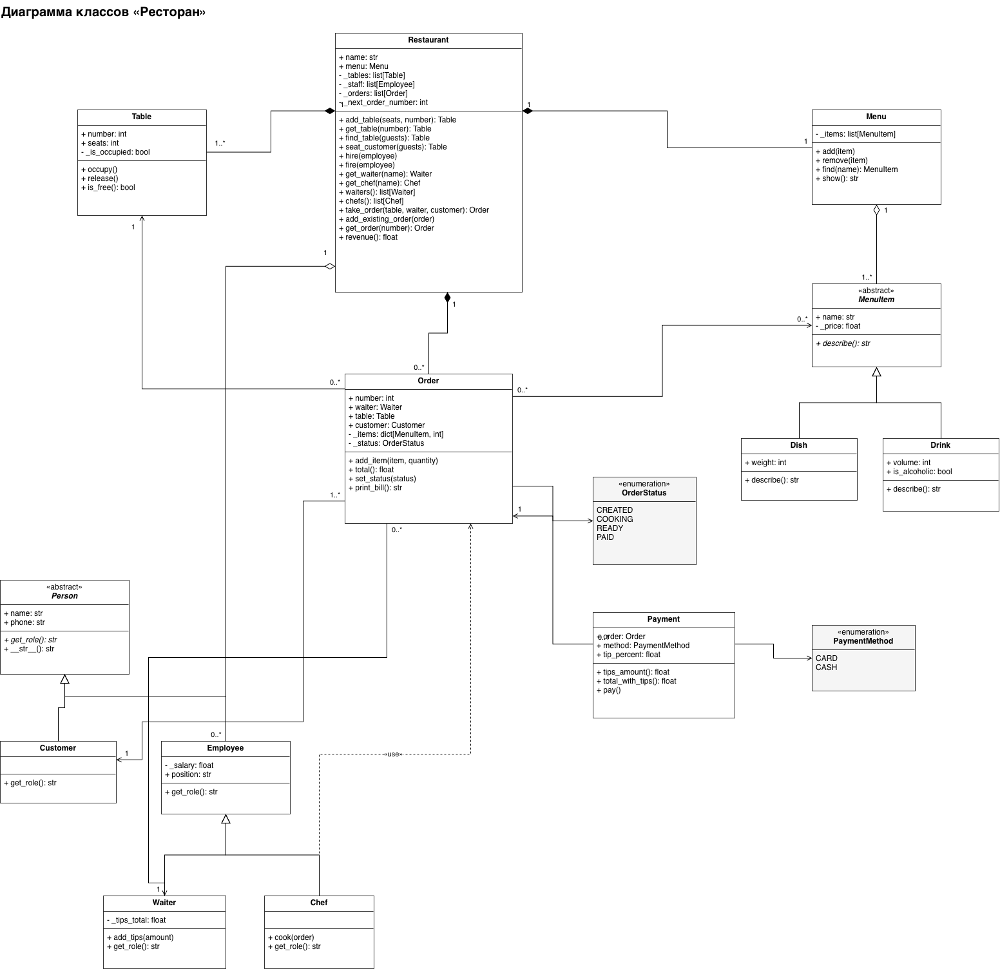
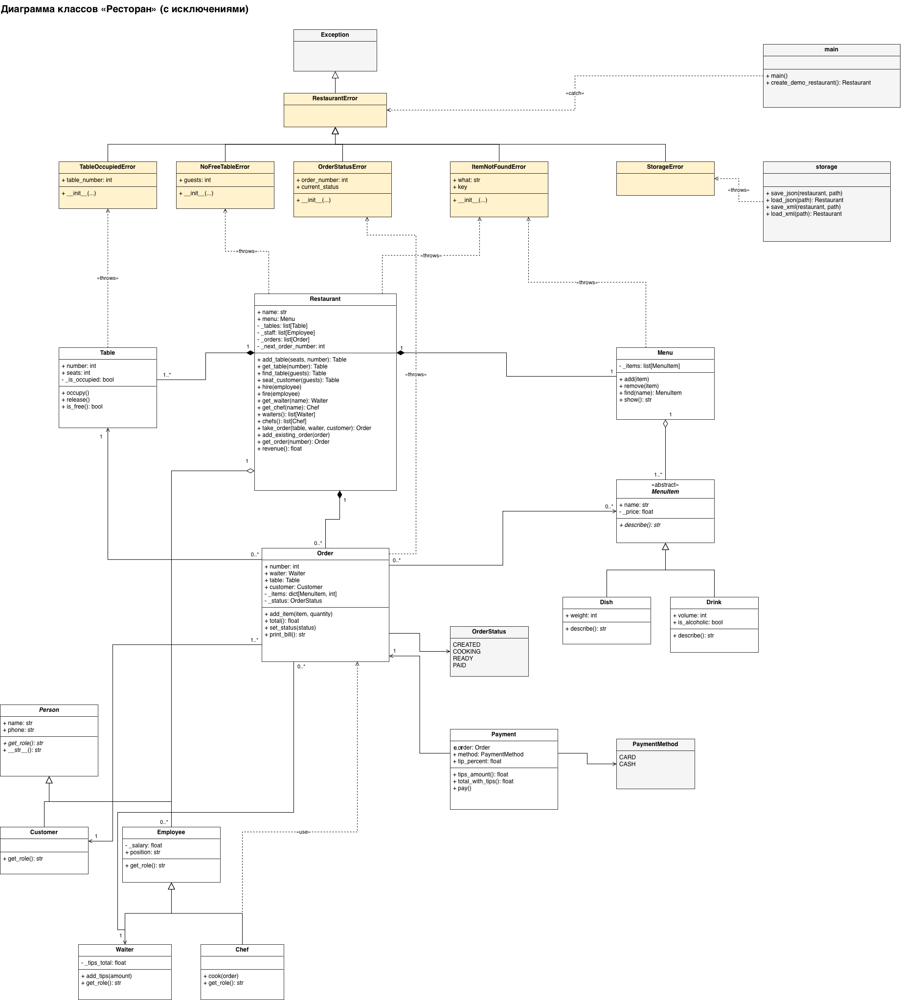

# Ресторан: ООП-модель на Python

Лабораторная работа №1 по дисциплине «Прикладное программирование»

**Выполнила:** Яковлева Анастасия Витальевна, группа ИДБ-25-11

## Задание

1. Спроектировать в draw.io диаграмму классов для предметной области «Ресторан» и написать по ней код на Python в объектно-ориентированном стиле
2. Обработать встроенные и собственные исключения, чтобы ошибки пользователя не приводили к завершению программы; актуализировать диаграмму классов
3. Спроектировать структуру хранения данных в форматах XML и JSON
4. Реализовать чтение из файла и запись в файл в форматах XML и JSON

## Диаграмма классов

Исходная модель (часть 1):

С исключениями (часть 2):

## Структура проекта

| Файл | Содержимое |
|---|---|
| `enums.py` | `OrderStatus`, `PaymentMethod` |
| `exceptions.py` | собственные исключения: `RestaurantError` и наследники |
| `people.py` | `Person`, `Customer`, `Employee`, `Waiter`, `Chef` |
| `menu.py` | `MenuItem`, `Dish`, `Drink`, `Menu` |
| `restaurant.py` | `Table`, `Order`, `Payment`, `Restaurant` |
| `storage.py` | чтение и запись JSON и XML |
| `main.py` | консольное меню, точка запуска |
| `data/` | данные ресторана в форматах JSON и XML |
