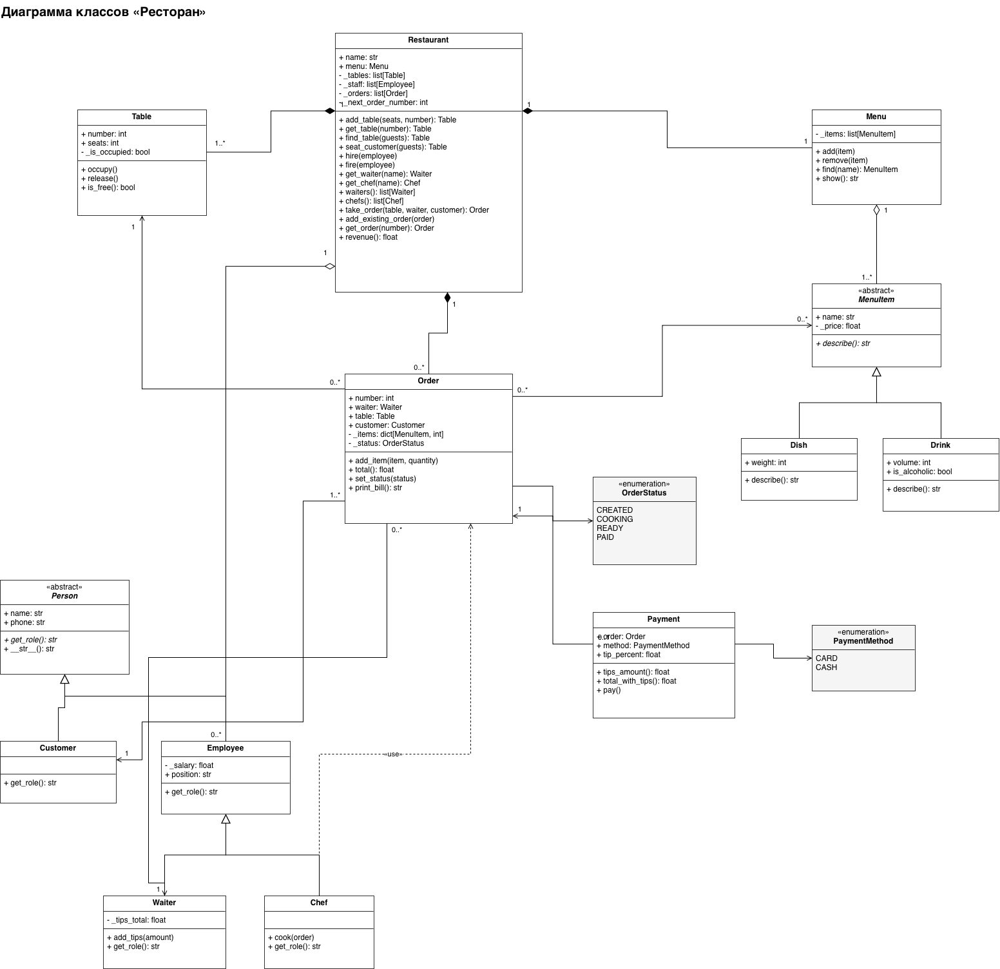
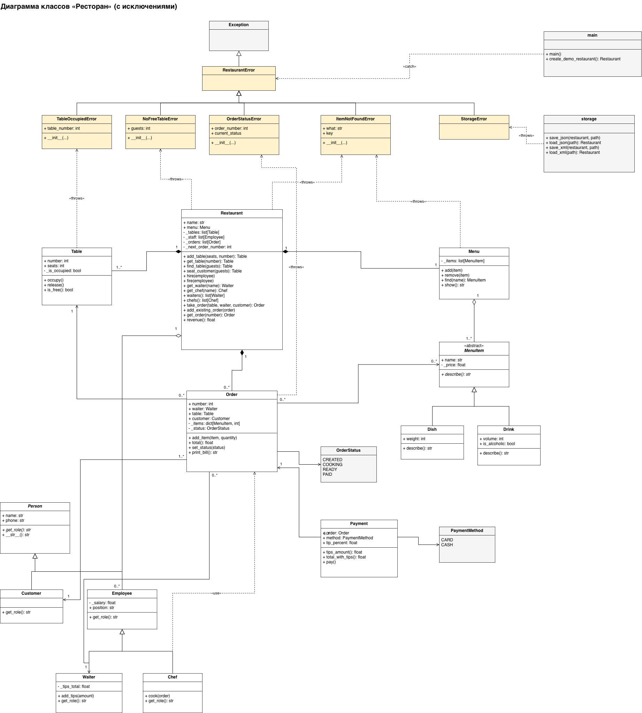

# Ресторан: ООП-модель на Python

Лабораторная работа №1 по дисциплине «Прикладное программирование».

**Выполнила:** Яковлева Анастасия Витальевна, группа ИДБ-25-11

## Задание

1. Спроектировать в draw.io диаграмму классов для предметной области «Ресторан» и написать по ней код на Python в объектно-ориентированном стиле.
2. Обработать встроенные и собственные исключения, чтобы ошибки пользователя не приводили к завершению программы; актуализировать диаграмму классов.
3. Спроектировать структуру хранения данных в форматах XML и JSON.
4. Реализовать чтение из файла и запись в файл в форматах XML и JSON.

## Диаграмма классов

Исходная модель (часть 1) — `diagram_v1.drawio`:



С исключениями (часть 2) — `diagram_v2_exceptions.drawio`:



## Структура проекта

Каждый класс находится в отдельном файле.

```
models/          классы предметной области
  person.py, customer.py, employee.py, waiter.py, chef.py
  menu_item.py, dish.py, drink.py, menu.py
  table.py, order.py, payment.py, restaurant.py
  order_status.py, payment_method.py
exceptions/      собственные исключения
  restaurant_error.py и 5 наследников
repositories/    репозитории сотрудников
  repository.py, waiter_repository.py, chef_repository.py
storage.py       чтение и запись JSON и XML
main.py          консольное меню, точка запуска
data/            данные ресторана в форматах JSON и XML
```

## Запуск

```
python3 main.py
```
